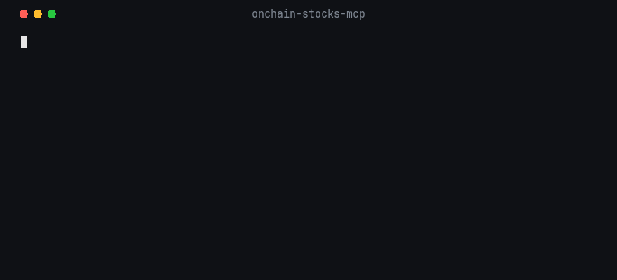

# onchain-stocks-mcp

MCP server for tokenized stocks on Solana: which token is cheapest, what size costs you, and how a buy compares to the real share.

Read-only. It never trades, holds keys or gives advice.



The demo runs with a key, which adds the comparison to the real share. Without one, the tokens are compared with each other.

## Install

No API key needed. Claude Code:

```
claude mcp add onchain-stocks -- npx -y onchain-stocks-mcp
```

Other clients (Claude Desktop, Cursor):

```json
{
  "mcpServers": {
    "onchain-stocks": {
      "command": "npx",
      "args": ["-y", "onchain-stocks-mcp"]
    }
  }
}
```

Then ask: "Which tokenized Tesla is cheapest to buy for $1,000?"

Needs Node 22+.

## Tools

Without a key:

| Tool | Returns |
|---|---|
| `list_tokens` | Every token covered (about 130 across 85 stocks): issuer, redeemability, mint |
| `compare_issuers` | The same buy quoted for every issuer's token of one stock (xStock, Ondo, Backpack...), ranked by price per token. With a key, also vs the real share price |
| `quote_sizes` | One token quoted at up to 5 sizes, and how much more each size pays per token than the smallest (slippage) |

With a [tokens.xyz](https://tokens.xyz) key (`TOKENS_API_KEY`), three more:

| Tool | Returns |
|---|---|
| `search_stocks` | Every token of a stock, plus the real share price and its age |
| `quote_buy` | The all-in cost of a buy against the real share price |
| `risk_score` | Market risk score 0 to 100, grade A/B/C |

Add the key with `-e TOKENS_API_KEY=your_key` before `--` in the Claude Code command, or as `"env"` in the JSON config.

## Read the numbers right

- Quotes are Jupiter routes, not fills, and not the issuer's own mint or redeem price. A token far above the others usually means a thin route.
- Tokens of one stock can differ in what they represent (redeemability, dividends). Check `redeemable`.
- Share prices are frozen outside US trading hours. Check `sharePriceAgeMinutes`.

## Limits

| Limit | Detail |
|---|---|
| Jupiter rate limit | The free quote API allows a short burst, then about one quote every 2 s per IP (measured 2026-11-01, `scripts/probe-jupiter.ts`). Each user runs the server locally, so limits are per user. Tools retry with backoff and cache identical quotes for 15 s |
| Real share price | Needs a tokens.xyz key. No free source exists: Pyth, the usual oracle, requires an API key since August 2026 |
| Token list | Built in, refreshed weekly by a pull request. Tokens launched since the last release are missing until then |
| Chains | Solana only |

## Data sources

| Data | Source |
|---|---|
| Buy quotes | Jupiter lite API (free, rate-limited: errors are returned, never guessed) |
| Built-in token list | api.tokens.xyz, refreshed weekly by a pull request (`npm run catalog` by hand) |
| Share prices, search, risk | api.tokens.xyz (key required) |

## Development

```
git clone https://github.com/stephanet88/onchain-stocks-mcp
cd onchain-stocks-mcp
npm install   # also builds dist/
npm test
npm run lint
npm run typecheck
```

Not investment advice.
